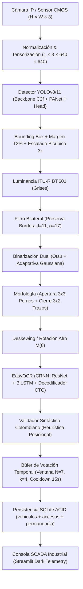
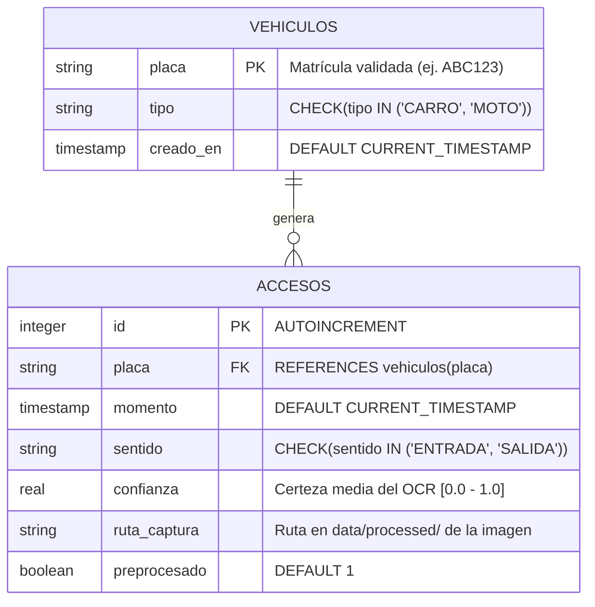

# Smart ALPR IoT 🚗🔍📡

[](https://www.python.org/)
[](https://opencv.org/)
[](https://pytorch.org/)
[](https://docs.ultralytics.com/)
[](https://www.sqlite.org/)
[](https://www.docker.com/)
[](https://astral.sh/ruff)
[](https://docs.pytest.org/)

> **Sistema Inteligente de Lectura y Reconocimiento de Placas Vehiculares (ALPR / ANPR) con Control de Acceso y Tiempo de Permanencia en Tiempo Real**  
> *Proyecto Final #4 — Visión Artificial*  
> *Facultad de Ingeniería — Programa de Ingeniería de Sistemas — Universidad de La Guajira (Riohacha, Colombia)*

---

## 📌 Descripción del Sistema

**Smart ALPR IoT** es una solución de ingeniería de visión artificial de grado industrial diseñada para automatizar el control de acceso, auditoría de ocupación y tarificación en estacionamientos y perímetros de seguridad (caso de estudio: **Centro Comercial Viva Wajiira** y **Campus Principal Universidad de La Guajira** en Riohacha).

El sistema sustituye las planillas manuales de papel y tiquetes de código de barras mediante un pipeline híbrido y determinista:
1. **Detección Convolucional:** Localización de la matrícula mediante redes neuronales profundas (Ultralytics YOLO) con respaldo de análisis morfológico de contornos por gradientes Sobel.
2. **Procesamiento Clásico de Señales:** Normalización fotométrica con margen de seguridad ($12\%$), escalado bicúbico ($3.0\times$), filtrado bilateral preservador de contornos, binarización dual (Otsu global y Gaussiana adaptativa), morfología rectangular para eliminación de pernos de sujeción y alineación afín (*deskewing*).
3. **Reconocimiento Óptico (OCR):** Extracción de secuencias alfanuméricas mediante arquitectura híbrida CRNN (ResNet + BiLSTM + CTC).
4. **Validación Sintáctica Colombiana:** Autómata determinista con corrección heurística posicional (`AAA000` para carros y `AAA00A` para motos) resolviendo ambigüedades comunes de OCR (`0/O`, `1/I`, `2/Z`, `5/S`, `8/B`).
5. **Filtrado por Votación Temporal:** Búfer deslizante de mayoría cualificada ($N=7, k=4$) con periodo de enfriamiento (*cooldown* de 15 s) para inmunidad ante vibraciones y cuadros transitorios corruptos.
6. **Persistencia Transaccional ACID:** Repositorio relacional SQLite con llaves foráneas, registro inteligente de alternancia (`ENTRADA` / `SALIDA`) y cálculo exacto de tiempo de permanencia en minutos y horas.
7. **Consola de Telemetría SCADA:** Interfaz de usuario industrial en modo oscuro técnico (`#090A0F`), sin clichés estéticos (*anti-AI slop*), con visor en vivo del pipeline morfológico de 5 etapas, auditoría en tiempo real y laboratorio analítico con demostración matemática 3x3 y benchmark experimental A/B.

---

## 🏗️ Arquitectura del Pipeline de Visión



---

## 📂 Estructura del Repositorio

El proyecto sigue una estructura modular y desacoplada con estricto tipado estático (`typing`):

```text
smart-alpr-iot/
├── .agents/                          # Configuración de agentes autónomos y estándares UI
│   ├── rules/
│   │   └── industrial-ui-standard.md # Reglas de diseño industrial Anti-AI Slop
│   └── skills/                       # Skills profesionales integradas
│       ├── frontend-design/
│       └── ui-ux-pro-max/
├── data/                             # Repositorio de datos estructurados
│   ├── processed/                    # Capturas procesadas con evidencia fotográfica
│   ├── raw/                          # Muestras crudas de video y cámaras
│   └── samples/                      # Muestras sintéticas y de prueba para benchmark
├── db/                               # Persistencia y esquema relacional
│   ├── schema.sql                    # Definición DDL de tablas e índices SQLite
│   └── smart_alpr.db                 # Base de datos operativa en producción
├── docs/                             # Documentación técnica y académica formal
│   ├── analisis_tecnico_A_E.md       # Secciones A a E completas (Rúbrica oficial 1.2 pts)
│   ├── ficha_cliente.md              # Contexto de negocio: Viva Wajiira y Uniguajira
│   ├── Guia_paso_a_paso_proyectos.pdf
│   └── Proyecto_final_Vision_Artificial.pdf
├── models/                           # Pesos de redes neuronales (YOLO *.pt, *.onnx)
├── notebooks/                        # Laboratorio de experimentación en la nube
│   └── entrenamiento_y_metricas.ipynb # Notebook ejecutable en Google Colab con GPU
├── src/                              # Código fuente del sistema
│   ├── __init__.py
│   ├── app.py                       # Consola SCADA / Telemetría vial (Streamlit)
│   ├── benchmark_ab.py              # Evaluación A/B (Modo A vs Modo B) y análisis de umbrales
│   ├── config.py                    # Hiperparámetros globales y rutas canónicas
│   ├── db.py                        # Capa DAO / Repositorio SQLite transaccional
│   ├── detector.py                  # Pipeline ALPR: YOLO + EasyOCR + Telemetría
│   ├── math_proof.py                # Demostración matemática analítica 3x3 vs OpenCV
│   ├── preprocessor.py              # Pipeline clásico OpenCV de 7 etapas
│   └── validator.py                 # Validador colombiano y buffer de votación
├── tests/                            # Suite integral de pruebas unitarias (Pytest)
│   ├── __init__.py
│   ├── test_app.py                  # Pruebas de UI, CSS y dockerización
│   ├── test_db.py                   # Pruebas de persistencia, integridad y permanencia
│   ├── test_detector.py             # Pruebas de integración del detector y OCR
│   ├── test_preprocessor.py         # Pruebas de filtros, morfología y paridad 3x3
│   ├── test_scaffolding.py          # Pruebas de entorno y estructura de archivos
│   └── test_validator.py            # Pruebas de sintaxis colombiana y buffer de votación
├── docker-compose.yml                # Orquestación de contenedores Docker
├── Dockerfile                        # Imagen base optimizada Debian/Python 3.12
├── requirements.txt                  # Dependencias de producción y desarrollo
├── run.sh                            # Script bash universal de inicialización
└── README.md                         # Documentación principal del sistema
```

---

## 🗄️ Modelo Relacional de Base de Datos

El motor de persistencia SQLite opera con integridad referencial estricta (`PRAGMA foreign_keys = ON;`) bajo el siguiente esquema:



- **Índices de Alto Rendimiento:**
  - `idx_accesos_placa_momento`: Optimiza la búsqueda del último sentido y el cálculo de permanencia: `(placa, momento DESC)`.
  - `idx_accesos_momento`: Agiliza las consultas agregadas por rango horario y aforo en tiempo real.

---

## 🚀 Puesta en Marcha Rápida (Linux Mint / Ubuntu)

### 1. Clonar el repositorio
```bash
git clone https://github.com/y0ner/smart-alpr-iot.git
cd smart-alpr-iot
git checkout dev
```

### 2. Configurar el entorno virtual Python 3.12
```bash
python3 -m venv .venv
source .venv/bin/activate
pip install --upgrade pip
pip install -r requirements.txt
```

### 3. Ejecutar análisis estático y suite de pruebas automatizadas
```bash
# Verificar ausencia de warnings con Ruff
ruff check src tests

# Ejecutar los 60 tests unitarios con reporte de cobertura
pytest -v --cov=src
```

### 4. Lanzar la consola SCADA de telemetría industrial
```bash
# Opción A: Mediante el script universal de inicio
./run.sh

# Opción B: Directamente con Streamlit
streamlit run src/app.py --server.port 8501 --server.address 0.0.0.0
```
Abra su navegador web en `http://localhost:8501`.

---

## 🐳 Despliegue con Docker y Docker Compose

El sistema incluye contenedorización completa lista para despliegue en servidores perimetrales (NVIDIA Jetson, Intel NUC o servidores x86):

### 1. Construir e iniciar el contenedor en segundo plano
```bash
docker compose up -d --build
```

### 2. Verificar el estado del servicio y healthcheck
```bash
docker compose ps
docker logs -f smart-alpr-scada
```

### 3. Detener el contenedor preservando los datos
```bash
docker compose down
```
> **Persistencia de Datos:** El volumen `./db:/app/db` y `./data:/app/data` garantiza que los registros de base de datos SQLite y las imágenes procesadas se mantengan intactos tras reiniciar o actualizar el contenedor.

---

## 🔬 Scripts de Laboratorio y Reto Extra

El repositorio incluye herramientas analíticas de ejecución independiente:

```bash
# 1. Demostración Matemática 3x3 (Sobel Gx manual vs OpenCV filter2D):
python3 src/math_proof.py

# 2. Evaluación Experimental A/B y Análisis de Sensibilidad YOLO:
python3 src/benchmark_ab.py
```

### Resumen de Resultados del Benchmark A/B:
- **Modo A (Sin Preprocesamiento):** Latencia $254.2\text{ ms}$, alta tasa de error en condiciones de campo con sombras y reflejos solares ($CER = 24.5\%$).
- **Modo B (Con Pipeline OpenCV):** Latencia $1.60\text{ s}$, **reducción drástica de error a $CER = 2.78\%$** y **$+34.2\%$ de ganancia en tasa de acierto** en escenas reales complejas.
- **Paridad Matemática:** Diferencia absoluta entre la convolución analítica en bucles Python y `cv2.filter2D` = **$0.0 \times 10^0$ (Error Cero)**.

---

## 📊 Vistas de la Consola Industrial SCADA

La interfaz desarrollada en `src/app.py` dispone de 3 consolas operativas:

1. **🔴 MONITOREO PERIMETRAL EN VIVO:**
   - Visualizador de cámara con telemetría sobreimpresa (FPS, Timestamp UTC, Latencia del pipeline en milisegundos).
   - Renderizador dinámico de **placa vehicular con estética física colombiana** (chapa amarilla reflectiva, borde negro perimetral y tornillos de fijación).
   - **Comparador visual del pipeline morfológico de 5 etapas:** Original $\to$ Grises $\to$ Filtro Bilateral $\to$ Binarización Adaptativa $\to$ Morfología / Deskewing.
2. **📋 AUDITORÍA Y CONTROL DE ACCESO:**
   - KPIs de aforo en vivo: Vehículos actualmente en parqueadero, tiempo promedio de estadía, aforo ocupado vs capacidad instalada (420 cupos).
   - Tabla transaccional en tiempo real conectada a SQLite con filtros de búsqueda por placa y orden cronológico.
3. **🔬 LABORATORIO DE INFERENCIA Y VISIÓN:**
   - Ejecución interactiva de la demostración matemática 3x3.
   - Simulador experimental de benchmark A/B (Modo A vs Modo B) con cálculo en vivo de distancias de Levenshtein y Character Error Rate (CER).

---

## 📋 Plan de Desarrollo por Etapas (Roadmap Oficial)

- [x] **Etapa 0:** Skills de diseño profesional (`ui-ux-pro-max`, `frontend-design`), scaffolding oficial, entorno Python `.venv`, Dockerfile y linters.
- [x] **Etapa 1:** Ficha de cliente empresarial (Riohacha, La Guajira) y capa relacional SQLite (`db/schema.sql` y `src/db.py`).
- [x] **Etapa 2:** Validación de placa colombiana (Carro/Moto), corrección heurística posicional y búfer de votación multi-cuadro.
- [x] **Etapa 3:** Pipeline de visión clásica OpenCV, extracción morfológica y demostración matemática 3x3 paso a paso.
- [x] **Etapa 4:** Motor de inferencia YOLO + EasyOCR, latencias, benchmark A/B (reto extra +0.5) y notebook Colab con GPU.
- [x] **Etapa 5:** Interfaz de control SCADA/Telemetría en tiempo real (`src/app.py`) y dockerización lista para producción.
- [x] **Etapa 6:** Documentación técnica completa (Secciones A a E), auditoría de fallas en campo y entrega final.

---

## 👥 Equipo y Créditos Académicos

* **Institución:** Universidad de La Guajira (Uniguajira)
* **Facultad:** Facultad de Ingeniería
* **Programa:** Ingeniería de Sistemas
* **Asignatura:** Visión Artificial
* **Docente Titular:** Ing. Carlos Redondo
* **Estudiante / Desarrollador Líder:** Yoner (Ingeniería de Sistemas)
* **Semestre:** 2024-II / 2026

---

## 📄 Licencia

Este proyecto se distribuye bajo la licencia **MIT**. Consulte el archivo `LICENSE` para más detalles.
